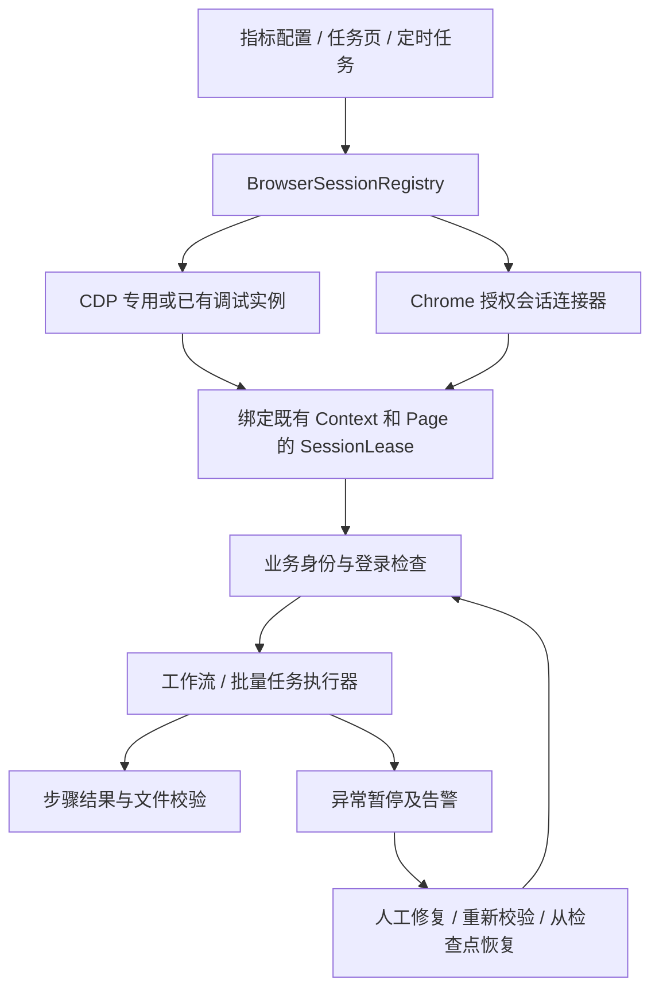

# 浏览器接管与登录态复用实施方案

日期：2026-10-27。范围：指标配置、工作流执行、批量任务、定时任务，以及主采集器的浏览器适配。

本文是基于当前源码及 Chrome / Playwright 官方资料制定的实施设计，尚未实现下述新接口，也尚未在客户专网、U-Key 和目标网站上完成实测。文中的配置、接口、模块名除“现状”明确列出的内容外，均为拟新增设计。

## 1. 结论与交付边界

可以让用户先打开 Chrome、手动登录，软件随后接管同一个浏览器会话并执行任务；也可以在该会话内自动登录后执行任务。

推荐分成两条接入路线，共享同一个会话管理和任务控制层：

1. **稳定主线：固定专用 Profile + 本机 Chrome + CDP 接管。** 用户通过软件生成的快捷方式手动打开 Chrome，或由软件启动同一个专用浏览器。登录和任务始终在所选会话里执行。最大程度复用当前 Python Playwright 执行器。
2. **现有普通浏览器接管：Chrome 144+ 授权会话连接。** 用户可以先正常打开 Chrome 并登录，再在 Chrome 内开启调试连接并授权。此路线需要验证新连接流程与现有执行器的适配，不能把 Chrome DevTools MCP 的 `--autoConnect` 直接当作 Python Playwright 的参数。

产品应提供“连接已有浏览器”和“打开专用浏览器”两个入口。连接失败明确报告原因，不悄悄新开浏览器、切换账号或重建 Context。

**交付承诺是：复用指定会话、可靠执行、异常暂停和可恢复。不能承诺接入后不会被反爬识别，也不能承诺网站登录永不过期。**

## 2. 当前项目实际行为

| 入口 / 模块 | 当前实现 | 对需求的影响 |
| --- | --- | --- |
| 指标配置页面 `frontend/src/renderer/src/pages/Indicators.tsx` | 调用 `/api/browser/open`、`status`、`close`；单步走 step stream | 只有打开 / 关闭，没有实例发现、连接和标签页选择 |
| `src/spider_gd/core/crawler/shared_browser.py` | `subprocess.Popen` 启动本机 Chrome，非零本机调试端口，`connect_over_cdp`，通常取默认 Context | 已经是系统 Chrome + CDP，并非简单使用 Playwright 内置 Chromium |
| 同上 | `tempfile.mkdtemp(prefix="shared-chrome-")`；关闭 Context / Browser / 进程并删除 Profile | 在软件进程存活期间共享，但不是跨重启保留的业务 Profile |
| 同上 | 首次只纳入一个已有页面，后续新增页面自动切为当前页面 | 接入用户多窗口浏览器时会漏页，也可能被无关新标签页抢走当前页 |
| `tools/workflow_runner.py` | 独立运行另走 `connect_or_launch`，随后 `browser.new_context()` | 即便浏览器相同，新 Context 也没有当前页面的完整会话 |
| 同上 `_do_login` | `restore_state` 路径会关闭当前 Context，再新建 Context | 接管外部浏览器后必须禁止这条逻辑，否则会破坏用户会话 |
| `tools/task_runner.py` | 自己连接 / 启动 Chrome，创建新 Context；可加载 storage state，仍安排登录阶段；结束关闭 Context / Browser | 批量任务没有复用指标配置页面的会话；必须同步改造 |
| 同上 `_cleanup_between_indicators` | 保留第一页、关闭其余页面，再回工作台 | 接管用户浏览器后不能沿用，会误关用户页面 |
| `src/spider_gd/app.py` 的定时任务 handler | 构造 `TaskRunner`，当前使用可见但离屏的执行方式 | 也必须使用统一会话，不能只改指标配置页 |
| `src/spider_gd/core/crawler/playwright_runner.py` | 另有 Chrome 启动和 CDP / persistent context 回退逻辑 | 主采集器应接入同一个会话提供者；否则仍有第二套登录与浏览器生命周期 |
| `tools/recon_tool/stealth.py` | 有独立启动参数、随机端口及可用的指纹覆盖脚本 | 与共享浏览器路径不一致；需要收敛，不能把脚本定义等同于所有入口已经注入 |

当前 `dismiss_modal(report_error=true)` 已有 `error_pause`、等待人工输入和抛错逻辑。但是指标页 step stream 的前端分支未处理 `error_pause` / `waiting_input`，后端该入口的告警主要在步骤最终抛错后发送。这不能作为“立即告警、整个任务持续暂停”的完整保障。现有文档描述的其他运行入口保障，需要逐条映射到指标页，不能直接视为所有入口一致。

## 3. “选择窗口 / 进程”应如何实现

Chrome 包含浏览器主进程、渲染进程、GPU 进程等。一个浏览器会话可有多个窗口，一个窗口可有多个标签页；PID 并不等于可独立控制的网页。

真正绑定的层级应是：

```text
浏览器实例 / 用户数据目录
  └─ 已有 BrowserContext
      └─ 用户选择的 page / target
          └─ 此任务打开且获准纳入的子页面
```

界面可以显示“窗口、进程”，但执行凭据应是 `session_id + context_id + target_id`。PID、进程创建时间、窗口标题、Profile 路径仅用于发现和核验。渲染进程 PID 可能随着导航变化，不作为执行绑定。

分清两种情况：

- 浏览器已经开放传统 CDP 端口：可以发现实例，连接后选择其已有页面。
- 普通浏览器既没有开放 CDP，也没有启用新版授权连接或安装桥接扩展：**仅凭 PID / 窗口句柄无法让当前 Playwright 执行器接管 DOM。** 需要用户开启支持的连接方式。

### 路线比较

| 路线 | 使用已有页面登录态 | 无需以 CDP 参数重新启动 | 当前代码改造量 | 建议用途 |
| --- | --- | --- | --- | --- |
| A：专用 Profile + CDP | 可以，必须复用已有 Context / Page | 首次打开需专用快捷方式；之后直接连接 | 较小，但需统一各入口 | 首期正式交付、长期值守 |
| B：Chrome 144+ 授权会话 | 可以 | 可以，但用户需启用功能并授权 | 连接适配需 PoC，可能涉及 Node 桥接 | 接管用户已经登录的普通 Chrome |
| C：自研扩展 + Native Messaging | 可以 | 可以，但需安装扩展及本机桥接 | 大，需重新适配执行能力 | B 被环境策略限制时的后续选项 |
| D：操作系统鼠标键盘 / UI Automation | 可以操作可见窗口 | 可以 | 与当前 DOM 执行器差异大 | 原生证书弹窗等局部补充 |

不把复制个人 Chrome Profile、复制 Cookie 数据库、注入其他进程列为方案。复制 Profile 不等于复制完整活动会话，还可能遇到锁、加密和扩展状态不一致。

## 4. 路线 A：专用浏览器，先完成稳定交付

### 4.1 浏览器启动与 Profile

固定使用本机安装的 Chrome、非无痕、可见窗口、专用持久用户数据目录。

- Windows：`%LOCALAPPDATA%\SpiderGD\browser-profiles\<account_id>`。
- macOS：`~/Library/Application Support/SpiderGD/browser-profiles/<account_id>`。
- 开发环境可显式配置到 `data/browser-profiles/<account_id>`，不要把生产登录态放进版本库。
- 一个账号 / 业务身份一个目录；目录 ID 由系统生成，不直接拼接用户输入。
- Profile 目录在普通关闭、断开连接、任务结束时都保留；清空登录数据是单独操作。
- 同一目录只允许一个 Chrome 实例使用。软件锁只约束软件自身，还要检查 Chrome 的实际占用；占用时复用或报错，不强制删锁文件。
- 从 Chrome 136 起，传统调试开关不能针对默认 Chrome 数据目录使用，必须使用非默认目录。[Chrome 官方说明](https://developer.chrome.com/blog/remote-debugging-port)

最小启动参数：

```text
<chrome executable>
--remote-debugging-port=<非零本机端口>
--remote-debugging-address=127.0.0.1
--user-data-dir=<专用持久目录>
<业务首页 URL>
```

首期不统一追加现有隐藏特征 / 关闭站点隔离等参数，不伪造 UA / WebGL / plugins。针对业务必需的参数通过对照测试单独保留。不要让“反检测参数越来越多”成为默认调试方向。

生成快捷方式时使用固定可配置端口，例如 9222，并先检查冲突。软件自动启动可以分配动态非零端口，记录 PID、进程创建时间、Profile 和端点；等待实际端点就绪并校验归属。现有“先分配再释放端口”的做法有竞争窗口，需要有限次数重新分配和重启，不把绑定成功视为 Chrome 启动成功。

### 4.2 用户流程

**手动登录：** 点击桌面“SpiderGD 业务浏览器”快捷方式 → 用户自行登录 → 软件“连接已有浏览器” → 选择目标页面 → 检查业务登录状态 → 执行任务。

**软件自动登录：** 软件“打开专用浏览器” → 连接同一个 Profile 对应的 Chrome → 检查是否已经登录 → 必要时执行登录流程 → 确认业务身份 → 执行任务。

两种流程共用后续任务链路。既有登录有效时，不重复填 PIN、不点击登录、不重建 Context。

### 4.3 复用要求

```python
browser = await pw.chromium.connect_over_cdp(endpoint)
context = browser.contexts[chosen_context_index]
page = selected_existing_page
```

接管模式下没有符合条件的已有 Context / Page 时，返回可操作错误，由用户选择创建业务页。不能自动 `browser.new_context()` 并声称复用了登录态。

连接本身不导航、不刷新、不关页、不调整所有窗口尺寸。绑定页必须由用户选择，且从所有已有页面中列出，不能固定取 `pages[0]`。不能把用户在浏览器里切换活动标签页，当作任务需要切换执行目标。

## 5. 路线 B：接管已正常打开的 Chrome

### 5.1 官方支持的流程

Chrome 144+ 提供活动会话授权连接能力。用户打开 `chrome://inspect/#remote-debugging` 启用功能；连接端请求会话时，Chrome 弹出授权提示，用户允许后继续。[Chrome 官方流程](https://developer.chrome.com/docs/devtools/agents/use-cases/auto-connect)

此路线可以复用普通浏览器已有登录态，无需先把用户已登录的会话搬到专用 Profile。授权连接仍属于调试 / 自动化接管，不代表不可检测。

需要明确：官方 `autoConnect` 默认选择 Chrome 判定的默认活动 Profile，并可访问该 Profile 的多个窗口。它不是通用的“传入任意 PID 即可接管任意 Profile”接口。多 Profile / 多渠道场景必须先验证能否定位用户选中的实例；无法确定时不宣称已绑定。[官方多 Profile 说明](https://github.com/ChromeDevTools/chrome-devtools-mcp/blob/main/docs/advanced-usage.md#automatically-connecting-to-a-running-chrome-instance)

### 5.2 接入现有项目的工程路径

先做独立验证，不直接替换整个执行器：

1. 核对客户 Chrome 版本、Stable / Beta 渠道、企业策略、实际使用 Profile 和证书扩展。
2. 使用官方 `chrome-devtools-mcp --autoConnect`，验证授权、列页、读取选中业务页、断开后浏览器存活。
3. 优先验证轻量接法：用户启用授权调试后，从其明确选择的用户数据根目录下的 `DevToolsActivePort` 读取端口与 WebSocket 路径，校验后使用项目实际安装的 Python Playwright 连接，并等待 Chrome 的人工授权。官方客户端源码也有这种端点发现方式；是否在客户版本完整可用仍需实测。文件不存在就报告未就绪 / 不支持，不猜端口，不读取 Cookie 数据库。[官方连接实现](https://github.com/ChromeDevTools/chrome-devtools-mcp/blob/main/src/BrowserManager.ts)
4. 完成“连接 → 选择已有页 → 弹窗 → 跨域 iframe → 新标签页 → 下载 → 断线重连”能力测试。连接成功不等于所有工作流能力可用。
5. 若 Python 无法完整复用此连接，则采用本地 Node 桥接官方客户端，并通过 `BrowserExecutor` 适配器接入；只有能力清单通过才向用户开放 B 模式。

Playwright 官方支持 `connect_over_cdp()` 接入现有 Chromium，但指出 CDP 连接与 Playwright 原生连接存在能力差异。当前项目只限定 `playwright>=1.40,<2.0`，不能默认具备最新选项。[Playwright 官方 API](https://playwright.dev/python/docs/api/class-browsertype#browser-type-connect-over-cdp)

如升级后使用 `no_defaults`，应先核对实际 Python Playwright 版本及下载行为；该选项是较新版本能力，不作为首期前提。

### 5.3 Node 桥接的具体边界

若确需桥接，采用 Python 后端 ↔ 本地 stdio / 私有 IPC ↔ Node 桥接 ↔ 授权 Chrome。由现有 YAML 确定性执行，不在运行链路增加 LLM。

桥接必须覆盖以下接口，按现有 YAML action 逐项验收：

- 页面列表、稳定页面 ID、绑定 / 导航、弹出页关联、关闭自有页。
- CSS / 文本选择器、可见性等待、点击、输入、勾选、悬停、选择、iframe 定位。
- 页面脚本、页面文本、截图、验证码图像读取、现有日期控件处理。
- 下载监听、请求结果读取、文件保存，以及项目已有 API fallback。
- DOM 弹窗和 JS dialog；原生证书窗口仍走人工或单独的 OS 适配。

**不能把 `locator()` 机械改成 `evaluate()` 就当作兼容完成。** Playwright 文本选择器、操作前等待、popup / download 事件和跨域 frame 都需要适配。若路线 B 仅部分可用，应显示为试验模式，并列出不支持的 action；任务预检即拒绝运行，不执行到一半才静默换浏览器。

客户端与依赖固定版本，连同运行时一起随应用离线分发。Electron 的存在不代表 Python 后端必然能调用一个系统 `node`。对官方桥接组件关闭使用统计、性能 CrUX 查询及自动更新检查，内网任务不运行在线 `npx @latest`。

因此路线 B 优先顺序是“发现已授权调试端点 → Python 原执行器”，只有不兼容时才引入 Node，避免先把所有 YAML action 重写一遍。

### 5.4 为什么不首期自研扩展

`chrome.debugger` 可以按 `tabId` 调用部分 CDP 域，但并非完整 Browser WebSocket 的等价替代；扩展需 debugger 权限，DOM 操作、跨域 frame 和下载仍要重新适配。[官方 debugger API](https://developer.chrome.com/docs/extensions/reference/api/debugger)

如果客户 Chrome 版本或策略不支持 B，但必须接管普通现有浏览器，再安排扩展 + Native Messaging。其权限、安装、企业分发和版本兼容构成独立交付项，不伪装成“增加一个选择窗口按钮”。

## 6. 统一会话架构



建议新增核心模型：

| 模型 | 关键字段 / 责任 |
| --- | --- |
| `BrowserInstance` | `instance_id`、connector 类型、Chrome 版本、PID / 创建时间、Profile 标识、端点、可连接原因 |
| `BrowserSession` | `session_id`、实例、既有 Context、选中 target、连接状态、会话代次 generation |
| `SessionLease` | `run_id`、账号 ID、会话 ID、互斥执行权、自有页面集合、释放策略 |
| `AuthState` | unknown / authenticated / unauthenticated / expired / wrong_account / challenge；最后检查时间 |
| `RunControl` | running / paused / recovering / succeeded / failed / cancelled；暂停原因、恢复动作、检查点 |

`BrowserSessionRegistry` 在统一后端事件循环内持有 Playwright 对象。不要跨线程 / 事件循环传 Page。若当前部署是多后端进程，需要指定单一浏览器 owner 服务并通过 IPC 调用，不能给每个进程各建一个“全局单例”。

### 6.1 所有权与清理

- `owns_process`：Chrome 是否由软件启动。
- `owns_profile`：Profile 是否为软件管理的专用目录。
- `owned_page_ids`：由当前任务创建的页面。
- `allowed_page_ids`：用户明确绑定或任务获准纳入的页面。

默认任务结束只释放 Lease，保持会话。断开连接只移除监听器并停止本次客户端连接，不对外部默认 Context 调用 `close()`，不终止外部 Chrome。具体 Playwright 版本的断开语义应由集成测试验证，不把所有 `close()` 视为等价。

“关闭浏览器”只适用于软件拥有的进程，且有任务占用时拒绝关闭并显示任务。清空 Profile 是另一个操作。软件崩溃重启后依据 PID + 创建时间 + Profile + 端点重新核验，防止 PID 重用；重连后也不能自动恢复旧步骤。

### 6.2 页面绑定和作用域

- 连接后枚举所有既有页面，按窗口 / 页面标题 / 业务域展示，初始不改动页面。
- 内部使用稳定 target / page ID；原有 `switch_tab.index` 在任务可用页面集合内映射，保留旧 YAML 能力。
- 新页面只有在 opener 属于任务且目标域被允许，或用户显式选择后，才纳入任务作用域。
- 新 popup 以点击前注册的预期事件关联，避免依靠当前页索引猜测。
- 关闭 / 清理只能触及 `owned_page_ids`；用户原有页只能在明确绑定的业务范围内执行。
- 用户关掉任务当前页、改变账号或导航离开允许域时，暂停；不回退到任意其他页面继续点击。
- 用户需要手动操作时点击“交给我操作”；软件暂停派发新动作，并等待当前动作到达安全边界。

### 6.3 并发与调度

同一会话 / 账号只允许一个修改页面状态的运行任务。指标单步、整工作流、批量、定时和补漏都通过同一队列获取 Lease。

暂停时保留会话占用，依赖该会话的后续任务排队。其他独立账号 / 会话可继续运行。“暂停整个任务”指当前运行实例及其后续指标 / 日期，不无差别停掉所有账号。

外部会话无人值守时断开或需要重新授权，任务进入 paused 并告警；不尝试自动点击 Chrome 的授权提示。需要全天无人值守时选用 A，按登录实际有效期设计人工介入机制。

## 7. 登录策略与成功判据

浏览器连通、页面存在、业务已登录是三个独立状态。

| 策略 | 行为 |
| --- | --- |
| `reuse_only` | 只使用已有登录态；未登录 / 过期就暂停，提示用户手动登录 |
| `reuse_or_auto` | 登录有效则跳过登录；确认为未登录后在同一页 / 同一会话自动登录 |
| `manual` | 等待用户登录，用户点击重新检查后通过校验才执行 |

用户选择“自动登录并执行”对应 `reuse_or_auto`，已经登录时也无须重复提交凭据。强制退出重登可作为单独显式操作，不混入任务启动。

登录验证按目标站点实测配置：

1. 目标域 / 路由合理，页面没有登录表单、证书错误或风控挑战。
2. 页面出现可信的已登录业务标识；读取企业 / 账号身份并与任务预期身份核对。
3. 优先利用页面已产生的业务响应；必要时调用已确认无副作用的身份 / 权限探测接口，校验业务码和身份。

具体探测 URL、业务成功码和身份字段需在专网侦察时确定，不编造接口。`HTTP 200`、有 Cookie、出现“工作台”文字均不能单独判定成功。

网络错误和缺少权限分别处理，不一律当成“登录过期”去反复登录；登录失效也不能只由固定状态码判断，应使用该站点已验证的响应语义。

保留当前 Page 最有利于保留其内存变量、sessionStorage 和活动应用状态。持久 Profile 主要改善跨启动的持久数据保留；Chrome 重启后 sessionStorage、内存状态、服务器会话和证书连接均不保证恢复。`storage_state.json` 只是部分认证数据快照，不能替代活动会话。[Playwright 认证说明](https://playwright.dev/python/docs/auth)

U-Key、证书驱动、浏览器扩展、Windows 证书存储、专网路由依然必须可用。DOM 自动化无法自动处理所有原生证书选择窗口或硬件 PIN 窗口；需要人工时进入明确等待状态。

## 8. 登录错误必须立即告警并暂停整个运行实例

满足项目 AGENTS.md 中的要求：点击登录后，若“数字证书连接失败”等错误出现，立即告警并 pause 整个运行实例。

### 8.1 状态规则

```text
running
  ├─ 登录有效 / 步骤成功 → 下一步
  ├─ 证书错误 / PIN 错误 / 失效 / 风控 / 断连 → paused
  │     ├─ 用户取消 → cancelled
  │     ├─ 超过等待期限 → failed（保留原因和现场）
  │     └─ 用户修复并申请恢复 → recovering
  │           ├─ 身份 / 页面 / 网络重新校验失败 → paused
  │           └─ 校验通过 → 从明确的安全检查点继续
  └─ 全部步骤和产物验证成功 → succeeded
```

暂停是持久运行状态，不仅仅发出一条 SSE 事件。当前步骤显示“等待处理 / 错误暂停”，整个任务及后续指标 / 日期停止推进，禁止 `step_done`、`workflow_done`、`task_done` 提前发出。

### 8.2 错误捕获和恢复动作

- 对登录提交阶段同时监听成功标志、DOM 错误弹窗和挑战页面，不只在之后碰巧执行到 `dismiss_modal` 才检查。
- DOM modal、JS `alert/confirm` 与 OS 原生窗口分别处理。JS dialog 在阻塞自动化时先记录内容再按策略处理；原生窗口无法读取时也不能自动判为成功。
- `dismiss_modal` 只忽略“等待弹窗超时且弹窗确实不存在”；DOM 查询、取证、点击等异常不能全部吞掉。
- 默认保留错误弹窗和页面现场，先写暂停状态、截图、错误文本、当前步骤 / 页面 ID，再触发告警。旧流程若要求关闭错误框，也不能清除错误状态或自动继续。
- 告警在进入 paused 的事件处理处发送，不能等待 `_wait_continue()` 返回后才告警；发送失败不解除暂停。
- 同一 `run_id + 原因 + 暂停代次` 去重告警；恢复后出现新错误可以再次告警。
- “继续”应明确为“重新检查后继续 / 重试登录 / 取消”，不能无条件越过失败步骤。当前错误路径恢复后仍直接抛错的逻辑也要统一。
- 没有前端连接或人工回调时，保存 paused 状态并释放执行协程；调度器不把它算完成，也不盲目自动重试。
- 前端 / SSE 断开不影响后台暂停状态。重连通过 `run_id` 获取快照和事件序号；应用重启后旧 running 进入待恢复，不自动重放。
- 在不可逆或结果不确定的动作后不自动重试。导出前后以“指标 + 日期 + 参数 + 产物记录”检查，避免重复下载、覆盖和重复提交。

暂停检查放在每个动作派发前，以及下载、循环、验证码重试等长操作内部。遇到明确 PIN 错误、证书服务失败、U-Key 拔出立即停止登录尝试，不能继续用通用验证码重试次数消耗 PIN 次数。

### 8.3 密码与凭据

改造运行入口时一并删除 `cert_password` 等敏感字段在 GET / SSE 查询参数中的传递，使用 POST 请求创建运行实例，凭据保存在操作系统凭据库并通过引用读取。日志中的 `_do_fill` 当前会输出 value，敏感输入必须统一脱敏；截图和运行产物设置访问与保留策略，不把业务 Profile 或 storage state 打进支持包。

## 9. 拟新增配置与 API

### 9.1 配置示例

以下为设计，不是现有配置解析器已经支持的键：

```yaml
browser:
  mode: attach_cdp                 # attach_cdp / managed_cdp / chrome_authorized
  profile_id: account_001
  endpoint: http://127.0.0.1:9222  # 仅 CDP；授权连接不假设固定 HTTP 端口
  target_origin: https://pm.gd.csg.cn
  close_on_task_end: false
auth:
  policy: reuse_only               # reuse_only / reuse_or_auto / manual
  expected_account_ref: account_001
  credential_ref: spider-gd/account_001/cert-pin
execution:
  serialize_per_session: true
  pause_on_auth_error: true
  pause_on_browser_disconnect: true
  pause_timeout_seconds: 1800      # 默认建议，可由现场值守制度调整
```

页面 target ID 属于当前连接代次，存于会话 / run binding，不能长期写死进任务 YAML。定时任务引用业务 Profile / 账号配置；获取可用会话后重新核对身份和目标页。

### 9.2 接口与控制面

| 拟新增接口 | 用途 |
| --- | --- |
| `GET /api/browser/instances` | 列出软件已知、用户配置和获准探测的本机实例及不可连接原因 |
| `POST /api/browser/sessions` | 通过明确 connector 连接 / 启动会话；返回 session ID |
| `GET /api/browser/sessions/{id}/pages` | 列举允许展示的业务页，供绑定 |
| `POST /api/browser/sessions/{id}/bind` | 绑定 context / target；核对 generation |
| `POST /api/browser/sessions/{id}/auth/check` | 返回业务身份与登录状态，不返回原始 Cookie / Token |
| `POST /api/browser/sessions/{id}/detach` | 只断开客户端 |
| `POST /api/browser/instances/{id}/close` | 关闭软件拥有且未被占用的实例 |
| `POST /api/runs` | 指定 session / profile、任务、登录策略，创建运行实例 |
| `GET /api/runs/{id}`、`GET /api/runs/{id}/events` | 状态快照、可重连事件流 |
| `POST /api/runs/{id}/pause`、`resume`、`cancel` | 统一人工控制，恢复时必须重检 |

运行控制以 `run_id` 索引，替换当前 `_continue_events[name]` / `_stop_flags[name]` 的同名覆盖风险。操作必须校验运行状态与暂停代次，迟到的“继续”请求不能放行下一次错误暂停。

实例发现优先使用软件登记的进程 / 端口、用户输入端点和用户授权会话；可结合当前用户进程参数核验归属，不扫全网或枚举大量端口。无法拿到 PID 时显示“归属未核验”，不能因为标题相同就选中。

本机 API / IPC 需要会话令牌和来源约束；传统 CDP 只绑定 loopback，端点和返回 WebSocket 主机同样校验为本机，禁跟随到远程的重定向。127.0.0.1 只能限制网络暴露，不能隔离本机其他进程。实际监听地址在启动后检查。

### 9.3 页面交互

```text
浏览器：未连接
[连接已有浏览器] [打开专用浏览器]

连接方式：已有 CDP / Chrome 授权连接
实例：渠道、版本、Profile、PID（可用时）、连接可用性
目标页：标题、域名、窗口信息（可用时）
登录策略：仅复用 / 失效时自动登录 / 手动登录

已连接：account_001 · 业务身份已验证 · 当前无任务
[检查登录状态] [执行] [断开连接]

错误暂停：数字证书连接失败
当前运行实例及后续指标已暂停；告警发送状态独立显示
[交给我操作] [重新检查后继续] [重试登录] [取消任务]
```

## 10. 按当前文件实施的工作包

| 工作包 | 修改位置 | 交付与验收 |
| --- | --- | --- |
| 会话核心 | `src/spider_gd/core/crawler/shared_browser.py`；新增 `browser_session.py` / `browser_registry.py` / connectors | connect / launch / detach / close 分离；持久 Profile；所有权；已有页绑定；真实断连状态；单实例启动互斥 |
| 工作流注入 | `tools/workflow_runner.py` | 统一 Lease；接管时禁止新建 Context 和 restore_state 重建；自有页清理；暂停检查；旧选择器兼容 |
| 批量任务 | `tools/task_runner.py` | 不再自己 new_context；按策略跳过登录；不误关外部页面；整个批次暂停与检查点恢复 |
| 主采集器 | `src/spider_gd/core/crawler/playwright_runner.py`、`session_provider.py`、`session_keeper.py`、`src/spider_gd/app.py` | 共用会话；登录失效进入策略层；定时与人工入口使用一致账号绑定 |
| API / 状态 / 告警 | `src/spider_gd/gateway/api/server.py`、执行日志和状态存储对应模块 | 新接口；POST 启动；run ID；即时暂停告警；可重连事件；持久暂停 |
| 前端 | `frontend/src/renderer/src/pages/Indicators.tsx`、任务运行组件及 API 类型 | 发现 / 连接 / 页面选择；连接态与登录态区分；完整处理 error_pause / waiting_input / 恢复 |
| 启动收敛 | `tools/recon_tool/stealth.py`、录制 / 侦察入口 | 核心业务不再独立随机创建 Chrome；开发工具显式选择会话；旧模式保留为明确的隔离测试模式 |
| 授权连接 | 新增 `chrome_authorized` connector，必要时新增本地 Node bridge | 能力探测；用户授权；多 Profile 边界；离线依赖；完整 action 兼容验收 |

### 实施顺序与估算

以下为单名熟悉项目工程师、现场环境可用时的粗略工程估算，不是已验证工期：

1. **连接与业务 PoC：1–2 个工作日。** A 完整业务登录 / 导出验证；B 授权与执行器兼容探测；记录精确版本。先决定 B 是否可直接复用 Python 连接。
2. **A 会话核心与生命周期：2–3 个工作日。** 连接、持久 Profile、绑定页面、独占 Lease、断开保留。
3. **全入口与登录 / 暂停统一：3–5 个工作日。** 工作流、批量、定时、主采集器、API / 前端状态一致；加入验收测试。
4. **现场与升级回归：1–2 个工作日。** Windows + 专网 + U-Key + 真实下载，跨天登录有效性观察。
5. **B 正式集成：直接连接适配成功时另计约 2–4 个工作日；若需完整 Node 执行适配约 5–10 个工作日或更多。** 由 PoC 的 action 覆盖结果重新估算，不把连接成功当作已交付。

A 的粗略合计为 7–12 个工作日。首期验收以 A 为稳定路径，同时交付 B 的明确兼容性结论；若“接管普通已开 Chrome”是首期硬要求，B 必须通过后才能宣布该需求完成。

## 11. 可立即执行的技术验证

下面是工程验证步骤，不是当前软件界面已经具备的新功能。命令会创建专用目录并打开 Chrome，应由执行验证的人选择运行；本次只编写方案，没有替用户启动或连接浏览器。

### 11.1 路线 A：手动启动专用 Chrome

Windows PowerShell，先确认 9222 未被其他实例占用；Chrome 若不在此路径，用实际安装路径替换：

```powershell
$chromePath = Join-Path $env:ProgramFiles 'Google\Chrome\Application\chrome.exe'
$spiderProfile = Join-Path $env:LOCALAPPDATA 'SpiderGD\browser-profiles\poc'
New-Item -ItemType Directory -Force -Path $spiderProfile | Out-Null
Start-Process -FilePath $chromePath -ArgumentList @(
  '--remote-debugging-port=9222',
  '--remote-debugging-address=127.0.0.1',
  "--user-data-dir=`"$spiderProfile`"",
  'https://pm.gd.csg.cn/portal/#/home'
)
Invoke-RestMethod 'http://127.0.0.1:9222/json/version'
```

macOS Terminal，同样先确认端口没有冲突：

```bash
"/Applications/Google Chrome.app/Contents/MacOS/Google Chrome" \
  --remote-debugging-port=9222 \
  --remote-debugging-address=127.0.0.1 \
  --user-data-dir="$HOME/Library/Application Support/SpiderGD/browser-profiles/poc" \
  'https://pm.gd.csg.cn/portal/#/home'
```

用户在打开的浏览器中自行登录，然后在另一个终端运行下面的脚本。保存为临时 `verify_attach.py`，Windows 用项目 `.venv\Scripts\python.exe verify_attach.py`，macOS 用 `.venv/bin/python verify_attach.py`。需使用项目已经安装 Playwright 的虚拟环境。

```python
import asyncio
from urllib.parse import urlsplit

from playwright.async_api import async_playwright


async def main():
    import os

    pw = await async_playwright().start()
    try:
        browser = await pw.chromium.connect_over_cdp(
            os.environ.get("SPIDER_CDP_ENDPOINT", "http://127.0.0.1:9222"),
            timeout=60000,  # 授权连接时为用户留出确认时间
        )
        candidates = [
            page
            for context in browser.contexts
            for page in context.pages
            if urlsplit(page.url).hostname == "pm.gd.csg.cn"
            and not page.is_closed()
        ]
        if not candidates:
            raise RuntimeError("没有已打开的业务页；请先在专用 Chrome 内登录")
        for index, page in enumerate(candidates):
            print(index, await page.title())
        chosen = await asyncio.to_thread(input, "选择上面显示的业务页编号：")
        if not chosen.isdigit() or int(chosen) >= len(candidates):
            raise RuntimeError("无效页面编号")
        page = candidates[int(chosen)]
        print("已接入已有页面：", await page.title())
        print("本脚本只验证连接；业务身份与登录有效性仍需正式探测器校验")
        await asyncio.to_thread(input, "确认浏览器页面未被重建后，按回车断开：")
    finally:
        # 停止本次驱动连接；不关闭用户 Context / 页面 / Chrome。
        await pw.stop()


asyncio.run(main())
```

后续把真实任务注入该 `context/page`，验证导出、日期选择和新标签页；不能通过调用当前 standalone `runner.run()` 来验证复用，因为它会重新走独立启动链路。

### 11.2 路线 B：普通 Chrome 授权验证

1. 使用已正常打开且已登录的 Chrome 144+，启用 `chrome://inspect/#remote-debugging`。
2. 在 `chrome://version` 查看 Profile 路径，取其用户数据根目录：例如路径以 `User Data\Default` 结尾时取 `User Data`，不能把 `Default` 当用户数据根目录。检查根目录的 `DevToolsActivePort`。存在时可先用下面的 Python 片段读取端点；以实际根目录替换示例路径：

```python
from pathlib import Path
from urllib.parse import urlsplit

user_data_root = Path("/实际路径/Chrome用户数据根目录")
parts = (user_data_root / "DevToolsActivePort").read_text().splitlines()
if len(parts) < 2:
    raise RuntimeError("调试端点文件内容不完整")
port_text, ws_path = parts[0].strip(), parts[1].strip()
if not port_text.isdigit() or not 1 <= int(port_text) <= 65535:
    raise RuntimeError("调试端口无效")
parsed = urlsplit(ws_path)
if parsed.scheme or parsed.netloc or not ws_path.startswith("/devtools/browser/"):
    raise RuntimeError("调试路径无效")
endpoint = f"ws://127.0.0.1:{int(port_text)}{ws_path}"
print(endpoint)  # 仅本机验证使用；正式软件不把调试端点写入普通日志
```

3. 在验证终端把 `SPIDER_CDP_ENDPOINT` 设为该地址，运行上节 `verify_attach.py`；在 Chrome 里人工允许连接。文件存在可能是残留信息，仍须通过连接结果、实例归属和页面身份核验。正式 connector 对授权拒绝、超时和旧端点分别返回错误。此接法是有源码依据的待验证适配，不表示已在本项目实测成功。
4. 若端点发现或 Python 适配不兼容，在独立、可联网的工程验证环境使用官方客户端进行对照，按官方 MCP 配置启动：

```json
{
  "mcpServers": {
    "chrome-devtools": {
      "command": "npx",
      "args": [
        "-y",
        "chrome-devtools-mcp@latest",
        "--autoConnect",
        "--no-usage-statistics",
        "--no-performance-crux"
      ],
      "env": {
        "CHROME_DEVTOOLS_MCP_NO_UPDATE_CHECKS": "1"
      }
    }
  }
}
```

5. 客户端完成 initialize / tools-list 后调用实际提供的列页工具；仅启动 stdio 服务不等于已经请求 Chrome 会话。用户在 Chrome 中允许调试会话；确定连接的是预期 Profile、页面和账号。
6. 记录工具 / 传输能力，并按第 5 节判断是否需要 Node 桥接。上面的客户端不是当前 SpiderGD 已有功能。验证结束冻结准确版本和依赖，生产构建使用离线包替换 `npx @latest`。

## 12. 测试与验收清单

先编写下面关键行为的回归测试，再实现核心状态和生命周期变化；连接与登录本身必须配合真实 Chrome 集成验证，mock 无法证明反爬和证书兼容。

| 场景 | 通过标准 |
| --- | --- |
| 手动登录后接管 | 使用用户选中的既有 Context / Page，不点击登录、不创建新 Context |
| 已有 Cookie 但登录已过期 | 不误判成功，按策略等待人工或自动登录 |
| 业务身份错误 | 暂停，禁止在错误企业账号下导出 |
| 同一会话自动登录 | 表单和指标任务绑定同一会话；登录成功后才启动指标 |
| 数字证书连接失败 | 立即 paused 和告警；当前及后续指标不再动作，不发完成事件 |
| PIN 错误 / U-Key 拔出 | 停止重试，保留现场，不耗尽 PIN 尝试次数 |
| 指标页单步 / 整工作流 / 批量 / 定时 | 四种入口执行相同的登录与暂停策略；主采集器也能绑定同一会话 |
| 用户关闭当前业务页 | 暂停，不跳到其他任意页面继续操作 |
| 用户新开无关标签页 | 不改变任务当前目标 |
| 用户已有多个标签页 | 连接不关页，指标间清理不误关外部页 |
| 两个任务同时执行 | 同一账号 / 会话串行；不同会话按配置独立 |
| 暂停与恢复竞态 | 迟到继续信号不放行新的暂停；继续前重新校验 |
| SSE 断开 / 前端关闭 | 后台状态准确；重新打开可查看并恢复暂停 |
| 软件重启 / Chrome 崩溃 | 旧任务进入待恢复，核验会话代次，不自动重放不确定动作 |
| 断开 / 任务结束 | 外部 Chrome、既有页面和 Profile 保留；可再次连接 |
| 持久 Profile 重开 | 持久数据仍在；业务登录过期可正确处理，不承诺强行续期 |
| 真实下载 | 文件完整落入当前日期目录、格式 / 大小有效、业务日期正确，不误报完成 |
| 新版本 Chrome | 固定 Playwright / 桥接版本兼容；升级后重测核心路径 |
| B 授权拒绝 / 企业策略限制 | 给出明确错误，不自动换成新 Chrome |

现场对照验证分四组：纯手工、只连接不执行、连接后少量页面动作、完整指标任务。在同一机器、账号、网络和相近时段记录业务成功率、挑战次数、登录失效、浏览器 / 执行器版本及错误原因。用结果判断风险是否改善，不能单看 `navigator.webdriver` 或没有横幅就认为不会被检测。

正式验收建议：选定当前已验证的 5 个工作流，在真实 Windows + U-Key + 专网环境完成单步、批量和计划运行；至少观察两个实际调度周期及一次登录失效恢复。测试覆盖的是约定环境和时间段内的稳定性，不能推出未来永不触发反爬。

## 13. 发布与回滚

- 新会话模式先使用显式配置开关，选定一个账号灰度；原有隔离模式保留用于回归。
- 旧任务未配置会话时明确使用 legacy 模式，不因升级自动接管个人浏览器。
- 迁移旧 `restore_state` / 首步 `login` 时保留导航语义，将认证统一交给 AuthPolicy；不能删除所有 action=login 后改变工作流跳转。
- 不在升级时复制个人 Profile；专用 Profile 初始化后由用户首次登录。
- 数据库新增状态 / 绑定字段采用兼容迁移；回滚只停用新 connector，不删除 Profile、已有产物和暂停记录。
- 回滚前结束或持久暂停活跃运行实例，释放 Lease；不能让旧执行器与新执行器同时操作同一个会话。

最终交付物：统一会话管理、两种登录方式、所有运行入口接入、准确的暂停恢复状态、快捷方式与现场手册、连接 / 登录 / 下载集成测试，以及路线 B 的明确兼容矩阵。
