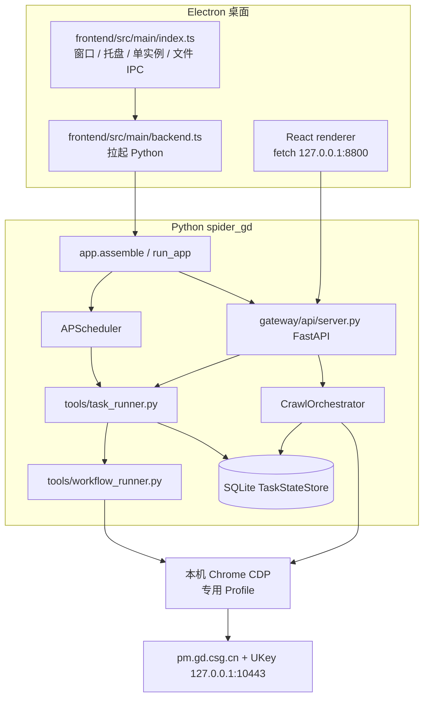

# spider-gd 架构说明

对照仓库当前代码整理。产品是跑在现场 Windows 上的广东电力交易数据采集客户端：用 U-Key 随身 WiFi 进入专网 `pm.gd.csg.cn`，在已登录的真实 Chrome 里按指标工作流取数，落到本机，再按配置上传或推送。

离线能采、能落盘是底座。告警和远程 Agent，以及 Web 控制台是可关的附加能力。`src/spider_gd/config/deploy_mode.py` 写明：业务代码不写 `if mode == ...`，由 `ModuleToggle` 决定装配什么。

编号文档 `docs/05_模块化架构设计.md`、`docs/00_项目地图.md` 仍描述模式 C 和 `cleaner.py`，以及「FastAPI 只有 4 个端点」。那些文件不在当前树里，控制接口也已经远多于 4 个。下文以源码为准。

## 1. 运行形态

桌面壳是 `frontend/`（Electron 44 和 electron-vite，以及 React 18 和 Ant Design 5）。业务数据不走 IPC。Preload（`frontend/src/preload/index.ts`）只暴露版本和数据目录，以及文件对话框和更新。页面通过 `frontend/src/renderer/src/services/api.ts` 调本机 HTTP。

`backend.ts` 的就绪条件是 `http://127.0.0.1:8800/openapi.json` 且 `info.title === "spider-gd 控制接口"`。开发环境用仓库 `.venv` 执行 `main.py --config configs/mode_dev.yaml run`。打包后跑 `resources/backend/spider-gd-service.exe`，并把 `SPIDER_GD_HOME` 设为 Electron `userData`，避免升级清掉安装目录里的库和日志（`src/spider_gd/config/user_home.py`）。

Python 入口是 `main.py` → `spider_gd.__main__`。`run` 走 `run_app()`：装配、注册调度，若 `web_ui` 打开则在同一事件循环里起 uvicorn。`_serve_web` 发现 8800 已被占用会直接退出，避免「进程在、接口不是这份后端」。

## 2. 两条采集链路

现场桌面走的是工作流 RPA。端点编排器仍在，但是另一条更早的 API 路径，默认端点还指向 `mock_site`（`configs/endpoints.yaml`）。

### 2.1 桌面主路径：任务 → 指标工作流

1. 指标定义存在 SQLite `workflow_configs`（YAML 文本）。文件兜底是 `SPIDER_GD_HOME/workflows` 或仓库 `workflows/`（`user_home.resolve_workflow_file`）。
2. 定时任务存在 `task_configs`：指标列表、每日/每周时刻、日/周/月窗口、路径模板、上传配置。旧的 `tasks/*.yaml` 只作回退（`app._load_task_config_from_yaml`）。
3. 手动执行走 `POST /api/tasks/{name}/run/stream`（SSE）。定时执行走 `app._task_runner_job`。
4. 跑之前：`prepare_wifi_connection()`，再 `ensure_dual_nic_ready()`（路由规则 + 双网卡闭环）。失败写入 `execution_logs` 并发告警，不继续点页面。
5. `tools/task_runner.py` 的 `TaskRunner` 登录一次，按指标顺序调用 `WorkflowRunner`，共用一个浏览器。
6. `tools/workflow_runner.py` 解释 YAML 步骤。已实现的 `action` 包括：`ensure_login`、`login`、`navigate`、`click`、`fill`、`check`、`select`、`hover`、`wait`、`pause`、`captcha`、`dismiss_modal`、`pick_date`、`pick_date_range`、`export`、`extract`、`extract_table`、`extract_echarts`、`extract_calendar`、`extract_calendar_month_weeks`、`select_calendar_week`、`intercept_api`、`collect_api`、`api_call`、`repeat`、`switch_tab`、`close_tab`、`close_other_tabs`、`screenshot`。
7. 登录弹窗、证书失败、站点不可达会 `_pause_login_error` / `_emit("error_pause")`，而不是把步骤标成完成。`dismiss_modal` 且 `report_error` 为真时同样暂停并等待人工继续（`BROWSER_SESSION.md`）。全局同时只允许一个任务占用浏览器；暂停也占着这条会话。
8. 下载按路径模板落盘。`{SSID}` 使用解码后的当前 WiFi 名。内容用 SHA256 比对：相同不覆盖，变化则旧文件进同目录 `_versions`，清单是 `.file_versions.json`（`core/pipeline/file_versions.py`）。
9. 结束后若开启自动上传，走 `gateway/data_upload_flow.py`。单个普通文件原样 POST；多个文件或文件夹先打成一个 zip（`gateway/data_uploader.py`）。`.file_versions.json` 和 `_versions` 不进上传列表。请求带配置里的自定义头、查询参数和表单字段。失败再试 3 次（连第一次共 4 次）。配置了上传用 WiFi 时先切过去，传完切回。
10. 另一条「稳定发送」在 `app.py`：企微 webhook / Server酱 / PushPlus / 本机微信，失败进 outbox，调度器每 5 分钟补发。这和上传配置不是同一个开关。

补数是 `POST /api/catchup/run/stream`，按日期范围重跑选定指标，不是编排器那条 `backfill` cron。

### 2.2 端点路径：CrawlOrchestrator

`core/crawler/crawl_orchestrator.py` 是 item 级状态机，不是一条直线：

`TaskLock` → SQLite `tasks` / `task_items` → `SessionKeeper`（412 则 refresh，再失败则完整重登，`asyncio.Lock` 防重入）→ `ApiFetcher` → 失败且配置了页面时 `RpaFetcher` → `DataProcessor` → `LocalLanding`。

- 续跑：同一个 `task_id` 只取仍为 pending 的 item。
- 任务状态由 item 汇总：全成功 `completed`，有成功有失败 `partial`，全失败 `failed`。
- 只有 `success > 0` 才 `compress_task` 并走 delivery hook。
- `ApiFetcher` 在装了 `curl_cffi`（extra `tls` / `online`）时伪装 Chrome TLS；否则退回 httpx。
- CLI：`python main.py crawl`。调度：`configs` 里的 `crawl_cron` 会对**全部**已加载端点跑「昨天」（`app._default_crawl_job`）。`backfill_cron` 用 `core/scheduler/backfill.py` 的限额、冷却和低优先级，避免补漏打满。

`configs/endpoints.yaml` 当前注册的是 `http://localhost:8000` 的 mock 端点，注释写明真实平台 URL 要等样本后再换。桌面联调配置 `mode_dev.yaml` 因此若同时开着调度，需要确认没有把 mock 端点的 cron 指到现场。

## 3. 模块职责

依赖方向（根 `README.md`）：`core` / `infrastructure` / `gateway` 只依赖 `interfaces/` 和 `config/`，不跨层引用对方的实现。装配集中在 `app.assemble()`。

| 路径 | 职责 |
|------|------|
| `interfaces/` | Protocol 与记录类型：爬虫会话、任务状态、调度、告警、健康、Agent |
| `config/settings.py` | pydantic-settings；YAML `inherits` 递归合并，环境变量盖敏感项 |
| `config/deploy_mode.py` | `standalone_wired` / `standalone_wireless` / `offline` 与 `ModuleToggle` |
| `config/logging.py` | loguru：滚动文件、按任务 sink、脱敏 |
| `config/user_home.py` | `SPIDER_GD_HOME` 迁移 `data/logs/tasks/workflows` 等；复制不移动 |
| `core/crawler/login_flow.py`、`captcha_solver.py` | 账密 + ddddocr 验证码（optional extra `ocr`） |
| `core/crawler/session_keeper.py`、`session_provider.py` | 412 链；从页面读 Token / Cookie |
| `core/crawler/shared_browser.py` | 单例 CDP Chrome，注入 `WorkflowRunner` |
| `core/crawler/ukey_manager.py` | USB 插拔与证书到期 |
| `core/crawler/task_lock.py` | `O_CREAT\|O_EXCL` 文件锁，默认 6 小时的过期锁可回收（`stale_after_sec`） |
| `core/pipeline/local_landing.py` | `{data_dir}/{YYYY-MM}/{YYYY-MM-DD}/{任务}_{执行时间}/`、台账 xlsx、zip |
| `core/pipeline/data_processor.py` | Excel 解析与缺口检测；字段标准化仍后置 |
| `core/dates.py`、`core/output_paths.py`、`core/path_structure.py` | 日/周/月窗口、`{SSID}` 等路径 token、目录大纲 |
| `core/station_profile.py` | 场站与 UKey / WiFi / 证书密码的 JSON 绑定，存在设置里 |
| `core/scheduler/` | APScheduler 封装、指数退避、补漏规划 |
| `infrastructure/storage/database.py` | SQLite WAL。业务文件不进库，库里是状态、设置、工作流和执行日志 |
| `infrastructure/network/` | USB、DNS 回退、路由、双网卡监督、WiFi、`decode_ssid_name` |
| `infrastructure/proc.py` | `run_capture`：Windows 控制台字节按代码页解，避免 `text=True` 把 stdout 解成 `None` |
| `infrastructure/monitor/health_checker.py` | 磁盘、UKey、专网、公网 |
| `gateway/api/server.py` | 控制面。健康、任务、工作流 CRUD 与 SSE、执行日志、设置、场站、网络、delivery、录制工坊、浏览器会话、补数、诊断包、上传配置、文件上传 |
| `gateway/control_service.py` | REST 与 Agent 共用的 crawl / health / tasks |
| `gateway/alert/` | 钉钉、企微、Server酱、PushPlus；关闭时 `NullAlertGateway` |
| `gateway/agent/` | 指令解析、`PermissionGuard`、handler：`trigger_crawl` / `health_check` / `query_result`。钉钉 Stream 客户端是占位，回传走 webhook |
| `gateway/mcp/server.py` | 只读 MCP：`query_tasks`、`get_task`、`health_check`。父应用 lifespan 必须进入 `session_manager.run()`，否则挂载后请求会报 task group 未初始化 |
| `gateway/data_uploader.py`、`upload_profiles.py` | 客户接口上传配置与打包 |
| `tools/build_workflow.py`、`tools/recon_tool/` | 录制生成 YAML；现场 HAR / 网络侦察 |

`pyproject.toml` 把 FastAPI 和 uvicorn 放在 extra `online`，`dingtalk-stream`、`mcp` 和 `curl_cffi` 也在这组。离线核心不依赖它们。验证码和 WMI/pywin32 也是可选 extra。

## 4. 部署与配置

| 文件 | `deploy_mode` | 相对 common 的模块开关 |
|------|----------------|------------------------|
| `configs/mode_d_offline.yaml` | `offline` | 告警、Agent、Web 全关。CLI 底座 |
| `configs/mode_a_wired.yaml` | `standalone_wired` | 告警 + Web |
| `configs/mode_b_wireless.yaml` | `standalone_wireless` | 与 A 相同。yaml 不写网卡差异 |
| `configs/mode_dev.yaml` | `offline` | 只开 Web，给 Electron 联调。告警关 |

有线/无线的路由、SSID 和双网卡在 SQLite 设置和 `/api/network/*` 里区分，模式 yaml 不写这项。现场路由脚本是 `deploy/setup_routes.ps1`，服务安装见 `deploy/nssm_service.bat`、`deploy/install.bat`。

`common.yaml` 里的平台域名和下载目录，以及调度和 delivery 默认值会被模式文件 `inherits` 合并。模式 C（双机）已在 `deploy_mode.py` 删除。

公网不可用时，`infrastructure/network/supervisor.py` 可以把联网附加降到离线，不停本地采集。这是运行时降级，和 yaml 里的 `deploy_mode` 不是同一个开关。

## 5. 桌面信息架构

`frontend/src/renderer/src/App.tsx` 的路由：

| 路径 | 页面 | 做什么 |
|------|------|--------|
| `/` | `pages/Tasks.tsx` | 定时任务卡片：增删改、导入导出、立即跑、补数据、路径和上传字段 |
| `/files` | `pages/Files.tsx` | 本机文件、打开目录、手动上传 |
| `/execution-logs` | `pages/ExecutionLogs.tsx` | 失败原因、日志、诊断包 |
| `/indicators` | `pages/Indicators.tsx` | 指标 YAML、分组、单步/整段回放 |
| `/record-workshop` | `pages/RecordWorkshop.tsx` | 录制、导出 zip、提交录制包 |

`layouts/AppLayout.tsx` 顶栏：`HealthIndicators`（UKey / 专网 / 公网，可应用路由）和 `BrowserSessionPanel`（打开专用 Chrome、检查登录和暂停/继续），以及当前 WiFi、诊断包和设置。侧栏默认折叠。

设置集中在 `components/SettingsModal.tsx`：站点与账号，WiFi 与双网卡，路由和 delivery，还有场站和导入导出。上传配置档在 `UploadProfilesPanel.tsx`。

进度是 SSE。`ProgressModal.tsx` 把 `error_pause` 和 `captcha_failed`，以及 `site_unreachable` 和 `gateway_rejected` 显示成暂停或失败，而不是成功结束。定时任务没有这份弹窗时，`App.tsx` 轮询 `scheduled_auto` 执行日志，再弹出 `ExecutionResultModal`。

## 6. 不变量

这些是改功能时容易踩破的约束，都有代码或 `AGENTS.md` 依据。

1. **中文控制台编码。** 后端以 `PYTHONUTF8=1` 启动。`netsh` / PowerShell / `wmic` 在中文 Windows 上是 cp936。禁止对这些命令 `subprocess.run(..., text=True)`。统一 `spider_gd.infrastructure.proc.run_capture`。
2. **SSID。** 纯 ASCII 的 WiFi 名 netsh 原样输出。含非 ASCII 字节时输出连续十六进制（`iPhone什么` → `6950686F6E65E4BB80E4B988`）。比较、展示、写入路径前必须 `decode_ssid_name`（先 UTF-8，再 GBK）。
3. **Low 完整性。** 沙箱可能给工程目录打 Low 标签，带标签的 exe 起不来 Chrome 沙箱，也写不了 Medium 的 `%TEMP%`。`shared_browser.py` 会检测完整性级别。修复脚本：`tools/fix_integrity_labels.ps1`。
4. **不要用调试端口 0。** `shared_browser._allocate_cdp_port`：`--remote-debugging-port=0` 会打开自动化标记，门户页变空白。必须绑一个非零本机端口。
5. **瑞数令牌与 UKey 本机套接字。** 启动参数关掉后台节流和 `LocalNetworkAccessChecks`。否则遮挡窗口后令牌过期，XHR 变成网关 400；Chrome 147+ 会拦住页面到 `127.0.0.1:10443` 的证书 WebSocket，界面出现「数字证书连接失败」。见 `shared_browser._build_launch_args`。
6. **隐藏运行不是真 headless。** 控制接口 `_resolve_browser_visibility` 把 `headless=true` 或 `minimized=true` 收成「离屏但仍可见的窗口」。真 headless 只留给环境变量 `SPIDER_BROWSER_HEADLESS`。
7. **浏览器会话。** 连接的是原 Chrome Context，保留 Cookie、localStorage 和页面内存，不是导出 Cookie 再新建 Context。CDP 只接受 loopback。执行中不能换绑定页。后端重启后旧运行标为已中断，不自动重放有副作用的步骤（`BROWSER_SESSION.md`）。
8. **同一任务名的文件锁。** `TaskLock` 保证编排器路径上同名任务只有一个进程。工作流路径另有「全局一个浏览器任务」的占用，两者不是同一把锁。
9. **上传包内容。** 多文件打成一个 zip；版本清单和 `_versions` 排除。内容没变但清单被重新确认的产物，仍可能进入本轮发送候选（`app._changed_download_files`），和「字节变化才上传」不是同一条规则。
10. **登录失败即暂停。** 点登录后证书/弹窗失败应告警并暂停整次运行，不能报步骤完成。实现落在 `WorkflowRunner._pause_login_error` 和前端 `error_pause`。

## 7. 数据落在哪

| 数据 | 位置 |
|------|------|
| 任务/指标/设置/执行日志/路由规则 | SQLite，默认 `storage.sqlite_path`（`./data/spider.db`，或用户目录下） |
| 采集文件 | `downloadDir` 或 `storage.data_dir`，再套路径模板 |
| 版本归档 | 文件旁 `_versions/` 与 `.file_versions.json` |
| 浏览器 Profile | Windows：`%LOCALAPPDATA%\SpiderGD\browser-profiles\default`（见 `BROWSER_SESSION.md`） |
| 浏览器连接状态 | SpiderGD 根下 `browser-session.json` |
| 发送/告警补偿 | delivery outbox 与 `alert_outbox.jsonl` |
| 端点清单 | `configs/endpoints.yaml`（API 链路，当前是 mock） |

SQLite 不保存 Excel 正文。这是 `docs/00` 里仍然成立的一条决策。
