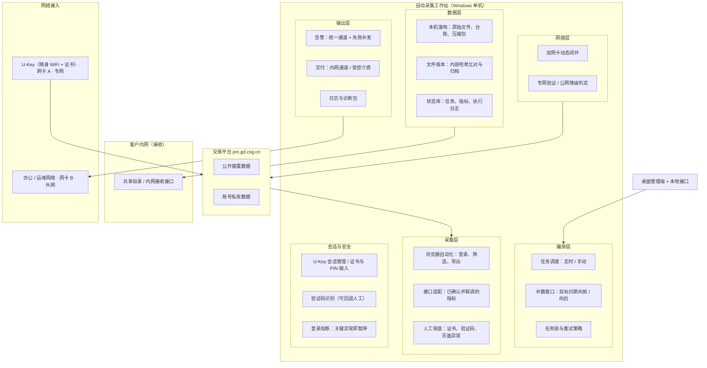
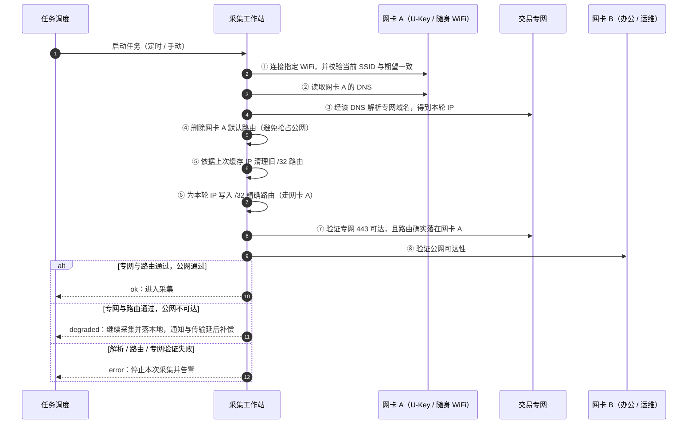
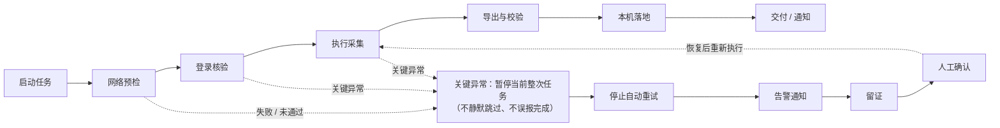
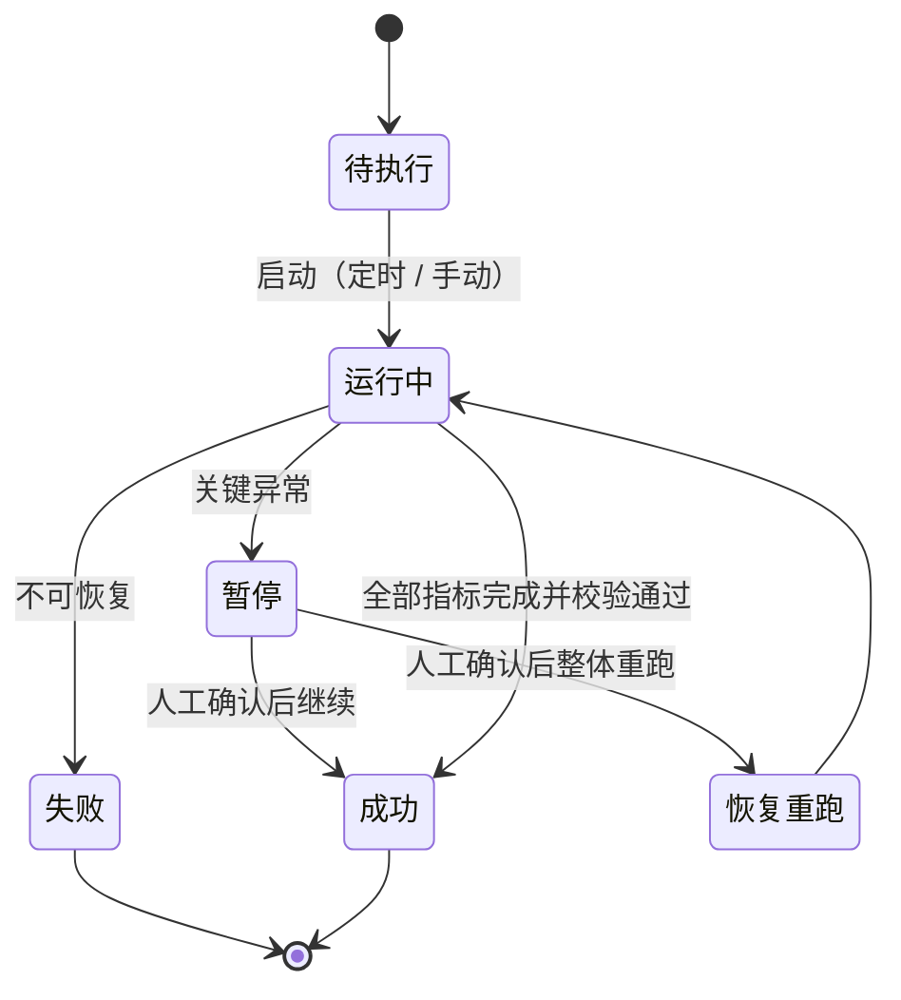
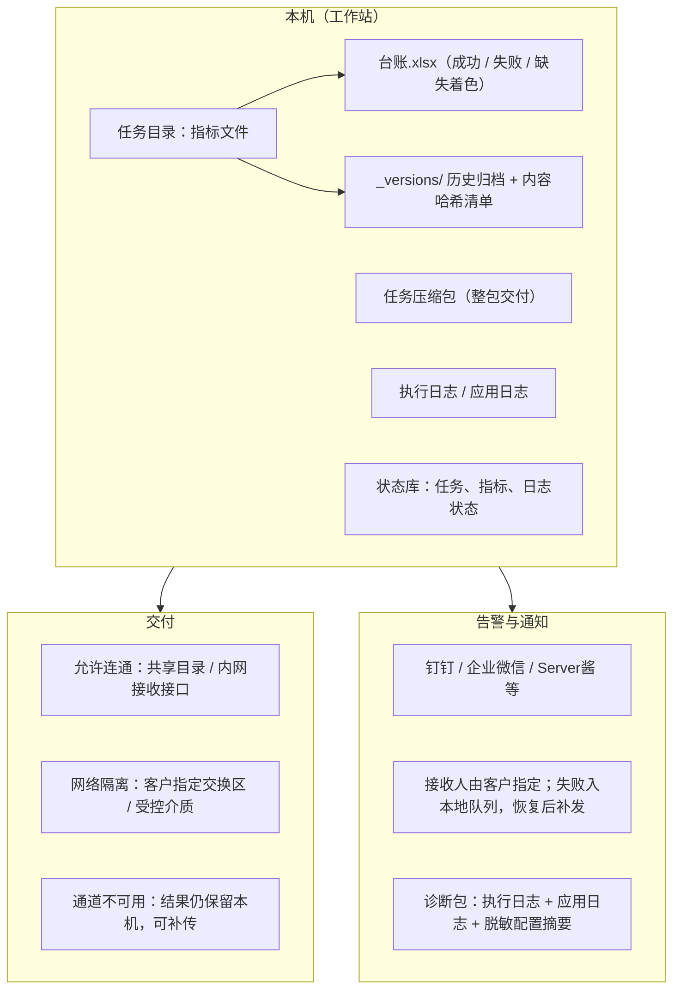

# 广东电力交易数据采集工作站 · 设计方案

| 项目 | 内容 |
| --- | --- |
| 文档版本 | V1.0 |
| 日期 | 2026.10 |
| 密级 | 商业机密（仅供双方项目组使用） |
| 编制方 | 【乙方公司名】 |
| 适用对象 | 客户技术 / 运维对接人员 |
| 配套文档 | 《广东电力交易数据采集解决方案 V3.3》（客户方案）、《实施与责任边界说明》 |

> 本文说明系统**怎么设计**：总体架构、双网卡网络设计、采集与异常处理、数据落地与交付、安全与运维设计。
> 方案范围、双方责任边界、实施与验收约定见《实施与责任边界说明》。

---

## 1. 设计目标与关键约束

### 1.1 设计目标

1. **把重复取数交给工作站**：定时或手动执行，按目标日期采集，产出可直接使用的文件。
2. **失败必须暴露**：关键异常暂停当前整次任务并告警，不静默跳过、不误报完成。
3. **数据先落本机**：采集与传输解耦，网络或交付通道不可用时结果仍可查询。
4. **适应现场条件**：专网入口、证书、验证码、页面改版等现实约束都在设计内处理。
5. **可运维、可追溯**：任务、步骤、文件版本、异常现场都可查；客户可自行操作与核对。

### 1.2 关键约束（设计出发点）

| 约束 | 说明 | 设计对策 |
| --- | --- | --- |
| 专网 IP 动态变化 | 专网入口为 U-Key / 随身 WiFi，域名对应 IP 会随拔插、DHCP、专网侧调整而变 | 不写死 IP：每次任务前经指定网卡重新解析并写入精确路由 |
| 证书与 PIN 由 U-Key 承载 | 登录依赖证书介质，PIN 输错会造成连续错误提交 | 登录熔断：关键异常立即停止自动重试并暂停 |
| 存在验证码 | 自动识别可能失败 | 有限次识别 + 人工保底；失败留证后交人工 |
| 页面可能改版 | 元素与流程会变化 | 采集配置与执行分离，按指标维护、可回放验证、可录制新流程 |
| 客户内网接收方式待定 | 接收通道、凭证、校验要求由客户确定 | 采集与传输解耦；交付路径可切换（连通 / 隔离） |
| 单机部署 | 工作站位于客户现场，需离线可用 | 离线为底座（无外网亦可完整采集落地），联网能力作为可选附加 |

---

## 2. 总体架构

### 2.1 架构图

<!-- fig:fig1-architecture -->



> 图 1 · 总体架构（矢量图 `figs/fig1-architecture.svg` ／ 位图 `figs/fig1-architecture.png`）

### 2.2 分层职责

| 层 | 职责 | 关键设计点 |
| --- | --- | --- |
| 编排层 | 决定“什么时间、采哪个日期、采哪些指标” | 定时（cron）与手动触发等价；补数窗口把目标日期展开为多天，从早到晚补 |
| 采集层 | 实际取数 | 页面自动化为主要路径；接口方式仅在已确认并完成联调的指标上启用；两者都失败时走人工保底 |
| 会话与安全 | 登录、证书、验证码、会话保持 | 登录成功以“进入工作台”为准，不以提交成功为准；关键异常触发熔断 |
| 网络层 | 打通专网访问并保持公网可用 | 双网卡动态闭环（见第 3 章） |
| 数据层 | 文件落地、版本管理、状态记录 | 内容哈希判重与归档；状态仅记状态与路径，不替代业务数据 |
| 输出层 | 告警与交付 | 通知通道统一；交付与采集解耦；日志与诊断包脱敏后外发 |

### 2.3 部署形态

- **单机部署**：采集、调度、落地、管理端都在客户工作站上；不依赖外部服务器。
- **桌面管理端 + 本地接口**：管理端提供任务配置、日历与运行结果、执行日志、指标配置、录制工坊；本地接口供管理端与现场工具调用。
- **离线底座**：无外网也能完整执行采集与落地；外网仅用于告警通知与可选的文件上传。

---

## 3. 双网卡网络设计（重点）

### 3.1 现场条件与问题

- 交易专网通过 **U-Key / 随身 WiFi** 接入，工作站上表现为一张专门的无线网卡（下称**网卡 A**）。
- 办公 / 运维网络（下称**网卡 B**）用于告警通知与可选的文件传输。
- 专网域名（`pm.gd.csg.cn`）对应的 IP 会随拔插、DHCP、专网侧策略调整而变化，**不能写死在配置里**。
- 若把专网网卡设为默认出口，会抢占公网；反之若不做定向路由，专网域名可能解析到错误出口。
- 两个网络**不做桥接**：仅对专网域名做定向访问，办公网络不被用于访问交易平台。

### 3.2 设计原则

1. **动态解析**：每次执行任务前，经网卡 A 的 DNS 重新解析专网域名，得到本轮 IP。
2. **精确路由**：只为本轮 IP 写 `/32` 精确路由，并指定走网卡 A；不写网段级大范围路由。
3. **默认路由不抢占**：删除网卡 A 的默认路由，保证公网出口仍是网卡 B。
4. **旧路由可清理**：缓存上轮 IP，用于清理上次遗留的 `/32` 路由，避免路由表堆积。
5. **失败不静默**：专网闭环不通过则停止本次采集并告警；公网不可达仅降级，不阻断采集。
6. **可验证**：闭环结束后逐项给出结论（解析、路由、专网 443、公网），不做“写了路由就算成功”。

### 3.3 动态闭环流程

<!-- fig:fig2-dual-nic -->



> 图 2 · 双网卡动态闭环（矢量图 `figs/fig2-dual-nic.svg` ／ 位图 `figs/fig2-dual-nic.png`）

### 3.4 逐步说明

| 步骤 | 动作 | 失败后果 |
| --- | --- | --- |
| ① WiFi 准备 | 连接配置指定的 WiFi；配置了期望 SSID 时校验一致，防止连错网络 | 任务失败并告警（可按配置降级为仅告警） |
| ② 定向 DNS | 读取网卡 A 分配的 DNS 服务器 | 任务失败并告警 |
| ③ 解析域名 | 仅经该 DNS 解析专网域名，得到本轮 IP 并缓存 | 任务失败并告警 |
| ④ 删默认路由 | 删除网卡 A 默认路由，公网出口保持网卡 B | 任务失败并告警 |
| ⑤ 清理旧路由 | 按上次缓存 IP 删除遗留 `/32` 路由 | 记录警告，不阻断 |
| ⑥ 写精确路由 | 为本轮每个 IP 写入 `/32` 路由，指定走网卡 A | 任务失败并告警 |
| ⑦ 专网验证 | 专网 443 可达 + 路由归属正确（必须同时满足） | 任务失败并告警 |
| ⑧ 公网验证 | 外网 HTTPS 可达性检查 | 仅标记 `degraded`，采集继续 |

### 3.5 结果三态与任务耦合

| 结果 | 含义 | 系统行为 |
| --- | --- | --- |
| `ok` | 解析、路由、专网、公网全部通过 | 进入浏览器 / 接口采集 |
| `degraded` | 专网与路由通过，公网不可达 | 采集继续，数据落本机；告警与上传进入本地队列，网络恢复后补发 |
| `error` | 解析、路由写入或专网验证失败 | 停止本次采集并告警，不做“带病”执行 |

- **任务前预检**：定时与手动任务在启动采集前都会先执行本闭环；只有通过（`ok` 或 `degraded`）才进入采集阶段。
- **手动可控**：管理端可单独执行“测试连接”（只验证 WiFi 准备）与“保存并应用”（连接 WiFi 后完整跑一次闭环并重新解析域名）。
- **不依赖上次 IP**：每次应用都重新解析，避免专网侧调整后仍用旧 IP。

### 3.6 使用前提与现场排障

**前提**

- 程序需要**管理员权限**（写入路由、读取网卡信息）。
- 需明确网卡对应关系：网卡 A = U-Key / 随身 WiFi 网卡；网卡 B = 办公 / 运维网卡。
- 如使用自动连接 WiFi，需预先配置 SSID 与密码（或系统中已有该 WiFi 配置）。

**排障顺序**（现场按此顺序排查最省时间）

1. 网卡列表中能否看到 U-Key / WiFi 网卡。
2. “测试连接”能否连上指定 WiFi；SSID 是否与期望一致。
3. 该网卡是否拿到 DNS。
4. 经该 DNS 能否解析 `pm.gd.csg.cn`。
5. `/32` 路由是否落在网卡 A（而不是公网网卡）。
6. 删除网卡 A 默认路由后，公网是否仍可达。
7. 程序是否以管理员权限运行。

---

## 4. 采集设计

### 4.1 工作流驱动

采集以**工作流**为单位组织（一个指标一套流程），采集配置与执行引擎分离。支持的步骤类型覆盖现场实际动作：

| 类别 | 步骤 | 说明 |
| --- | --- | --- |
| 登录 | 打开登录页、填写凭据、验证码识别、错误弹窗处置、登录保护熔断 | 登录成功以进入工作台为准 |
| 导航 | 跳转、点击、悬停、下拉选择、切换 / 关闭标签页 | 兼容新标签页打开的业务页面 |
| 日期 | 单选日期、日期区间 | 按目标日期自动定位年月日，远日期不依赖连续点击 |
| 取数 | 导出下载、拦截接口、采集接口返回、直接调用接口、表格 / 图表提取 | 页面与接口两类路径 |
| 校验留证 | 断言检查、截图、人工暂停 | 失败现场自动截图 |

### 4.2 三种采集方式如何协同

1. **浏览器自动化（主要路径）**：模拟人工操作完成登录、筛选、导出，覆盖大多数指标。
2. **接口适配（按指标启用）**：仅对已确认并完成联调的指标启用，用于提升稳定性与速度。
3. **人工保底**：证书、验证码、页面异常等无法自动处理的场景，暂停并等待人工介入。

> 不承诺所有指标同时支持页面与接口两种方式；接口范围以真实接口确认与现场验收为准。

### 4.3 登录、会话与登录熔断

- **证书登录**：U-Key 提供证书，登录过程中的证书密码 / PIN 由配置提供；证书或 PIN 异常会被识别为关键异常。
- **验证码**：自动识别有限次重试；失败则保存现场截图并转人工输入，不无限重试。
- **登录熔断**：出现证书连接失败、PIN 错误、登录后未进入工作台等情况时，**立即停止自动登录重试**并暂停当前整次任务 —— 避免 U-Key 被连续错误提交、避免“看似成功”的假象。
- **会话隔离**：多次执行之间清理会话，减少上一次状态对本次采集的影响。

### 4.4 异常暂停与人工接管

<!-- fig:fig3-execution-flow -->



> 图 3 · 任务执行链路与异常熔断（矢量图 `figs/fig3-execution-flow.svg` ／ 位图 `figs/fig3-execution-flow.png`）

**会触发暂停的关键异常**

- 证书连接失败 / PIN 错误
- 登录未成功（提交后未进入工作台）
- 验证码识别耗尽
- 专网不可达 / 路由写入失败
- 站点不可达（连接被拒绝、重置、DNS 失败等网络层错误）
- 导出失败且该指标未配置备用路径

**触发后的系统动作**

| 动作 | 说明 |
| --- | --- |
| 停止自动重试 | 立即中断后续重试，避免 U-Key / PIN 被连续错误提交 |
| 告警通知 | 通过统一通知通道发出，接收人由客户指定 |
| 留证 | 现场截图 + 执行日志 + 诊断包，便于远程定位 |
| 等待人工确认 | 人工处理后恢复当前任务或整体重跑 |

<!-- fig:fig5-task-states -->



> 图 5 · 任务状态与“暂停”语义（矢量图 `figs/fig5-task-states.svg` ／ 位图 `figs/fig5-task-states.png`）

**口径**

- 暂停作用于**当前整次任务**；人工确认后恢复或整体重跑，不承诺任意步骤的无损续跑。
- 失败会向任务层传播，任务状态不会停留为“已完成”。
- 公网不可达不属于失败：采集继续，数据落本机，通知与传输延后补发。
- 每个指标独立记录结果，便于按指标核对与重跑。

---

## 5. 数据落地、版本与交付

<!-- fig:fig4-data-delivery -->



> 图 4 · 落地、版本与交付（矢量图 `figs/fig4-data-delivery.svg` ／ 位图 `figs/fig4-data-delivery.png`）

### 5.1 本机落地结构

```
data/
  <任务名>_<执行时间>/
    指标文件（xlsx / csv / json 等）
    台账.xlsx
    _versions/（内容变化时的历史归档）
    .file_versions.json（当前与历史内容哈希）
  <任务名>_<执行时间>.zip        # 整包交付
logs/                             # 执行日志与运行日志
状态库                            # 任务、指标、执行日志、路由规则、交付队列
```

- **台账**：按指标输出成功 / 失败 / 缺失状态并着色，便于业务一眼核对。
- **压缩包**：整次任务的产物打包，作为交付单元。

### 5.2 文件版本策略（按内容判断，不按时间）

1. 计算新文件内容哈希（SHA256）。
2. 与当前文件哈希一致 → **不覆盖**，视为内容未变化。
3. 内容变化 → 新文件落在原路径，旧文件归档到 `_versions/`。
4. 记录归档时间、大小与哈希；管理端可查看当前哈希与历史版本。

> 该设计解决“同一天重复执行是否会覆盖正确文件”的问题：内容一致不产生冗余版本，内容变化不丢历史。

### 5.3 交付路径

| 场景 | 交付方式 | 说明 |
| --- | --- | --- |
| 允许连通 | 共享目录 / 内网接收接口 | 可配置自动上传，并验证下载链接可访问；失败重试且支持人工补传 |
| 网络隔离 | 客户指定交换区 / 受控介质 | 工作站只负责产出与压缩包，传递由客户流程控制 |
| 通道不可用 | 结果保留本机 | 网络恢复后补传，采集不受影响 |

内网接收的文件校验、接收回执等按客户要求对接（属实施阶段约定范围）。

---

## 6. 调度与补数

- **定时执行**：按 cron 表达式的周期计划执行；计划变更后热加载，无需重启。
- **手动执行**：与定时执行走同一条链路，便于现场验证。
- **目标日期窗口**：每次执行把“目标日期”展开为窗口 —— 向前 N 天表示从早到晚补数（默认向前 1 天），向后 M 天表示从今天起覆盖 M 天。
- **日期一致**：目标日期同时作用于页面选择与产出文件名，保证“选的是哪天、文件就是哪天”。
- **人工确认后重跑**：暂停或失败后，由人工确认再执行，避免无人值守下反复失败。

---

## 7. 告警与运行可见性

| 能力 | 说明 |
| --- | --- |
| 统一通知通道 | 钉钉 / 企业微信 / Server酱 / webhook 等，按客户环境选择；任务失败、登录失败、网络异常走同一出口 |
| 接收人可控 | 接收人由客户指定；可按需配置静默时段，避免非工作时段打扰 |
| 失败补发 | 告警发送失败写入本地队列，网络恢复后自动补发，不丢告警 |
| 执行日志 | 每次执行记录步骤级日志与失败原因，支持一键下载与上传 |
| 诊断包 | 执行日志 + 应用日志（最近若干行）+ 脱敏配置摘要 + 健康检查 + 网络诊断 |
| 运行可见 | 首页以日历展示每天的定时任务与执行结果；可查看当天任务明细与步骤日志 |
| 文件可见 | 文件中心查看落地结果、打开目录、查看文件版本与历史文件 |

---

## 8. 安全与合规设计

| 项目 | 设计 |
| --- | --- |
| 凭据保存 | 账号密码、证书 PIN 保存在工作站本机配置中，仅采集程序读取；如需接入客户密码管理系统或加密存储改造，另行确认 |
| U-Key 使用 | 仅使用证书完成登录，不复制、不导出证书文件；U-Key 由客户保管与领用登记 |
| 数据边界 | 采集数据落在客户工作站本机，交付到客户内网；不引入第三方云端存储 |
| 外发内容 | 仅告警摘要（任务名、时间、失败原因）与脱敏后的诊断包；不含账号密码、证书 PIN |
| 外发开关 | 客户环境不允许外发时，可关闭通知与上传，改为纯本机留痕 |
| 操作留痕 | 任务与步骤日志、失败现场截图、文件版本记录本地留存，作为追溯与验收依据 |
| 权限最小化 | 建议采集账号专用（不与人工共用），人员变动时及时回收与变更 |
| 审计 | 可按客户要求提供执行记录与文件版本清单 |

---

## 9. 可靠性与异常设计

| 设计点 | 说明 |
| --- | --- |
| 任务互斥 | 同一任务运行期间有锁保护，避免定时与手动重复触发造成并发采集 |
| 有限重试 | 登录、验证码等重试次数有上限；耗尽即暂停，不做无限重试 |
| 内容幂等 | 文件按内容哈希判重，重复执行不产生无意义覆盖 |
| 断网处理 | 专网失败停止采集并告警；公网失败降级继续，数据先落本机，事后补发 |
| 不误报完成 | 失败向任务层传播；暂停是显式状态，界面标红当前步骤 |
| 可定位 | 失败现场留证（截图、日志、诊断包），远程即可初步判断 |
| 可回放 | 采集流程可按指标单独配置与回放验证，页面改版时便于快速修正 |

---

## 10. 部署与实施

### 10.1 运行环境

| 项目 | 建议 |
| --- | --- |
| 操作系统 | Windows 10 / 11 64 位（以现场实测为准） |
| 硬件 | 4 核 / 8GB 内存及以上，SSD 100GB 可用空间 |
| 显示 | 1920×1080 及以上；采集运行期间需保持交互式桌面会话（自动锁屏 / 休眠会中断采集） |
| 网络 | U-Key 网卡（专网） + 办公 / 运维网卡各一；需管理员权限运行 |
| 浏览器内核 | 随安装包分发，无需客户单独安装 |

### 10.2 安装与分发

- 后端以独立可执行程序分发（首次启动自动准备配置目录）；桌面管理端为安装包形式，支持版本更新提示。
- 支持开机自启 / 安装为系统服务（按客户运维要求选择）。
- 各部署形态通过**配置切换**（单机有线 / 单机无线 / 纯离线），业务配置无需改动。

### 10.3 实施步骤

| 阶段 | 内容 | 退出标准 |
| --- | --- | --- |
| 一、单链路试点 | 现场环境确认；1 个交易单元、首批代表性指标接入；账号 / U-Key / 专网联调 | 登录成功；文件与业务口径一致；异常能暂停并告警 |
| 二、日常运行 | 定时执行与补数；异常处理流程固化；告警接收人确定 | 正常能跑、失败能停；执行记录可追溯 |
| 三、扩展交付 | 内网接收通道对接；按业务优先级增加指标；按需增加交易单元 / U-Key | 接收可核对、归属清晰；新增指标逐个验收 |

多 U-Key 轮转与跨交易单元并发属规划能力，按独立原型验证，不与上述阶段捆绑。

---

## 11. 验收要点

1. **采集正确性**：按客户指定的账号权限、指标、业务日期比对产出文件。
2. **网络可用性**：专网闭环通过（解析、路由、专网可达），公网出口不被抢占。
3. **异常路径**：断网、证书 / PIN 异常、验证码失败、导出失败时能暂停、告警、留证。
4. **数据交付**：客户内网接收端可核对文件内容与归属。
5. **不通过情形**：静默跳过失败、误报完成、文件与业务口径不一致。

---

## 12. 附录

### A. 架构图与源文件

| 图 | 内容 | 文件 |
| --- | --- | --- |
| 图 1 | 总体架构（分层与外部系统） | `figs/fig1-architecture.svg` ／ `.png` |
| 图 2 | 双网卡动态闭环（8 步与三态结果） | `figs/fig2-dual-nic.svg` ／ `.png` |
| 图 3 | 任务执行链路与异常熔断 | `figs/fig3-execution-flow.svg` ／ `.png` |
| 图 4 | 落地、版本与交付 | `figs/fig4-data-delivery.svg` ／ `.png` |
| 图 5 | 任务状态与“暂停”语义 | `figs/fig5-task-states.svg` ／ `.png` |

> 正文中的 Mermaid 代码块与上述矢量图内容一致；矢量图可直接插入其它文档，位图用于 Word 插图。

### B. 术语

| 术语 | 含义 |
| --- | --- |
| 专网 | 电力交易专网，交易平台的访问通道（经 U-Key / 随身 WiFi 接入） |
| 内网 | 客户内部网络，数据交付的接收方 |
| 外网 | 办公 / 运维网络，用于告警通知与可选传输 |
| U-Key | 随身 WiFi + 证书介质，同时提供网络接入与证书身份 |
| 工作流 / 指标 | 一个指标对应一套采集流程配置 |
| 补数 | 对历史目标日期的回溯采集 |
| 台账 | 按指标记录成功 / 失败 / 缺失的汇总表 |
| 留证 | 失败现场截图、执行日志与诊断包 |
| 闭环 | 一次完整的专网解析、路由写入与可达性验证过程 |

### C. 参考文档

| 文档 | 用途 |
| --- | --- |
| 《广东电力交易数据采集解决方案 V3.3》 | 面向业务的方案概览 |
| 《实施与责任边界说明》 | 范围边界、前提条件、责任划分、里程碑与验收 |
| 内部设计与实施说明（按需提供） | 模块设计、网络实施与现场侦察说明 |
